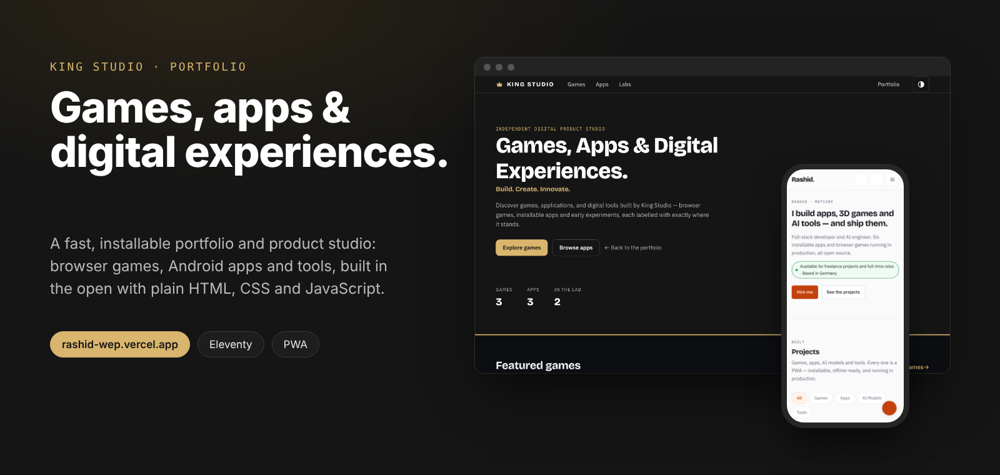
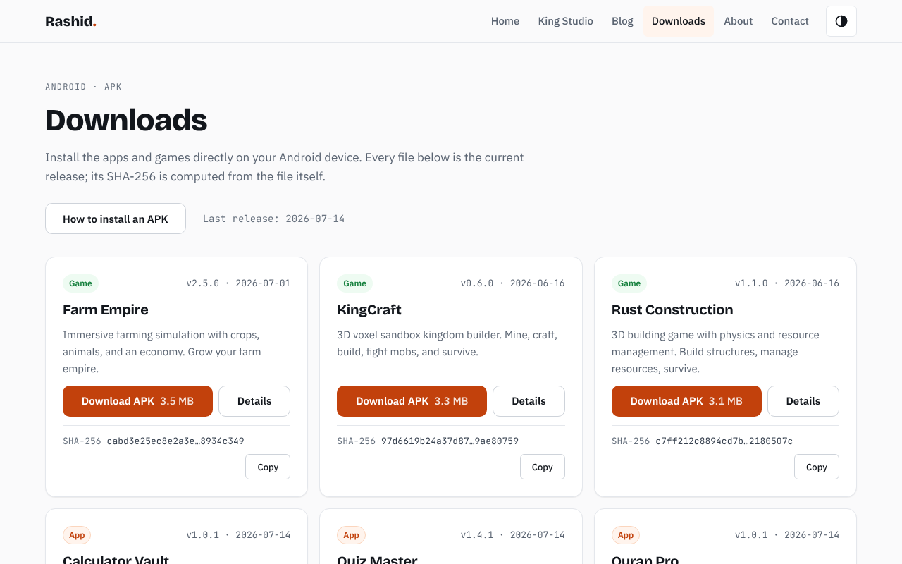
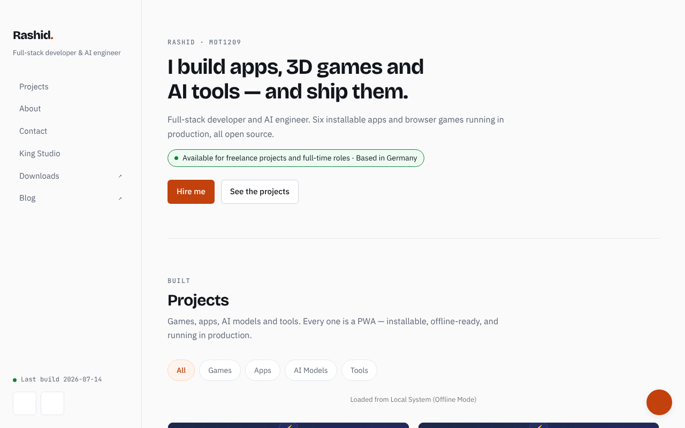
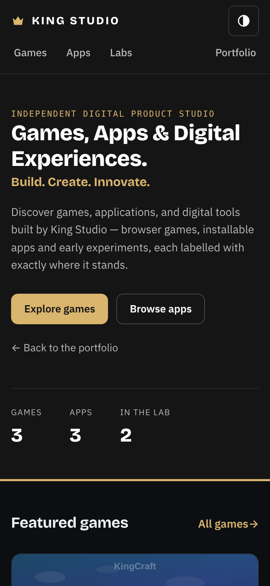
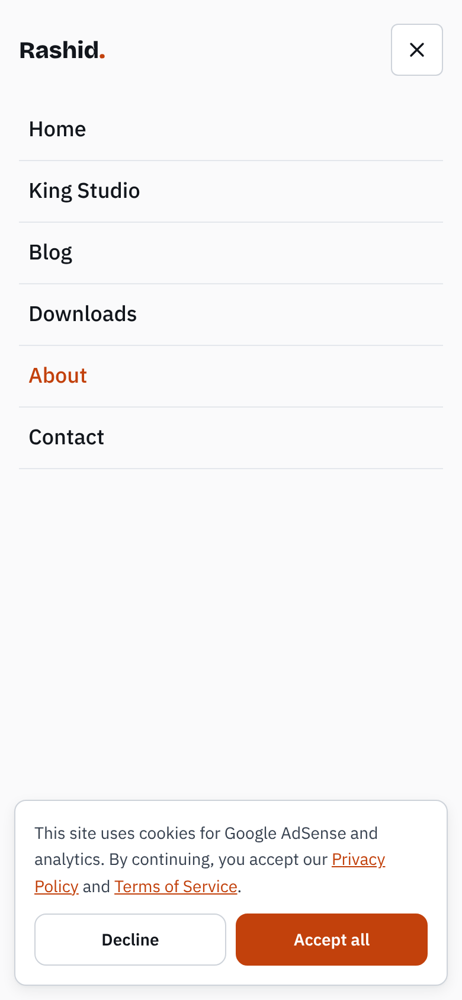

<div align="center">



<br/>

# Rashid · King Studio

**Games, apps and digital experiences, built in the open.**

A fast, installable portfolio and product studio. Browser games, Android apps and tools,
a blog and a downloads page, written in plain HTML, CSS and JavaScript on top of Eleventy.

<br/>

[](https://rashid-wep.vercel.app)
[](https://rashid-wep.vercel.app/king-studio/)
[](https://github.com/MOT1209/mein-wep/actions/workflows/ci.yml)

[](https://github.com/MOT1209)
[](https://www.youtube.com/@مختبرالبرمجه)
[](https://www.tiktok.com/@programmierlabor)

</div>

---

## What's inside

<table>
  <tr>
    <td width="33%" valign="top"><b>🎮 Games</b><br/>KingCraft, Rust Construction and Farm Empire. 3D browser games with Android builds.</td>
    <td width="33%" valign="top"><b>📱 Apps</b><br/>Quran Pro, Calculator Vault and Quiz Master. Installable, work offline.</td>
    <td width="33%" valign="top"><b>🧪 Labs</b><br/>Rashid AI and Block World. Experiments, each labelled with its real status.</td>
  </tr>
  <tr>
    <td width="33%" valign="top"><b>⬇️ Downloads</b><br/>Every Android APK with a SHA-256 computed from the file at build time.</td>
    <td width="33%" valign="top"><b>✍️ Blog</b><br/>Articles on Three.js, PWAs, Supabase, CSS and AI.</td>
    <td width="33%" valign="top"><b>📚 Vault</b><br/>Prompts, code, docs, media and API references.</td>
  </tr>
</table>

<br/>

<div align="center">


</div>

---

## Made for every screen

The whole site shares one design system and one navigation. A phone gets a full-screen menu with 44px touch targets, a desktop gets the inline header, and light or dark follows the visitor's choice and is remembered between pages.

<div align="center">


</div>

---

## Quick start

```bash
git clone https://github.com/MOT1209/mein-wep.git
cd mein-wep
npm ci          # Node 20 or newer

npm start       # dev server with live reload
npm run build   # build to dist/
npm run verify  # dist/ must equal the tracked, servable files
npm test        # run `npm run build` first for the dist checks
```

---

## King Studio catalogue

The games, apps and labs pages are generated from data, so a dead link cannot be published.

```text
_data/studioCatalog.json   one record per project
_data/kingStudio.js        validates it at build time: a missing launch URL, image or APK fails the build
king-studio/*.njk          landing page, Games / Apps / Labs, one detail page per project
```

**Add a project:** add a record to `studioCatalog.json`, then run `npm run build`. APK versions come from `apks/updates.json`.

---

<details>
<summary><b>Repository layout</b></summary>

<br/>

```text
.
├── index.njk                 homepage
├── about / contact / privacy / terms .njk
├── 404.njk  downloads.njk  learning.njk
├── blog/*.njk                index and posts (keep their .html URLs through permalinks)
├── king-studio/*.njk         King Studio pages
├── _includes/                layouts and partials (shared header, footer, King Studio)
├── _data/                    site.json, studioCatalog.json, kingStudio.js, downloads.js, releases.js
├── css/                      tokens.css, site.css, home.css, king-studio.css, ...
├── js/                       site-nav.js (menu, theme), downloads.js, king-studio.js, ...
├── src/js/                   homepage modules
├── games/  apps/             standalone PWAs, copied as they are
├── apks/                     Android builds and updates.json
├── api/                      Vercel serverless functions
├── vault/  models/  admin/
├── scripts/                  build tooling and the URL-surface gate
├── tests/                    node:test suites
└── vercel.json               headers (CSP), rewrites, redirects
```

</details>

<details>
<summary><b>How the build works</b></summary>

<br/>

- Only `.njk` files are templates. Everything else is copied file by file from `git ls-files`, so `dist/` can only hold tracked, intended files.
- Files that must not be served (docs, tooling, other sub-projects, secrets) are listed in `eleventy.config.mjs` and mirrored in `scripts/check-url-surface.mjs`. **New files must be `git add`-ed before they appear in `dist/`.**
- A template that renders to a fixed `.html` URL needs an explicit `permalink` and an entry in `scripts/site-templates.mjs`, so the URL gate knows about it.

</details>

<details>
<summary><b>Design system</b></summary>

<br/>

Pages share `css/tokens.css` (colour, spacing, type, `--tap: 44px`) with `css/site.css` on top. The homepage adds `css/home.css`, King Studio adds `css/king-studio.css` (charcoal and gold). Breakpoints: 640px, 1024px, 1280px. The theme is stored under the `theme` key in `localStorage` and applied as `data-theme` on `<html>`.

The older `css/style.css` is still used by `devos.html`, `vault/*` and a few pages that have not been migrated yet.

</details>

---

## Deployment

- **Vercel** project `rashid-wep` deploys `main` to https://rashid-wep.vercel.app with `npm run build`. Pull requests get preview deployments.
- **GitHub Actions:** `CI` runs the secret scan, build, verify and tests. `Build APKs` builds the Android apps with Capacitor and publishes them to a GitHub Release (see [`docs/APK_HOSTING.md`](docs/APK_HOSTING.md)).
- Environment variables for `api/*` (Supabase, Gemini and others) live in the Vercel project settings, never in the repository.

> [!WARNING]
> The repository root is the deploy root. Do not run `git add .` or `git add -A` blindly. Stage files by explicit path and check `git status` first, so internal folders and secrets cannot reach the public site.

---

<div align="center">

**Contact** · [zwnt45602@gmail.com](mailto:zwnt45602@gmail.com) · [GitHub](https://github.com/MOT1209) · [rashid-wep.vercel.app](https://rashid-wep.vercel.app)

<sub>Built in the open by Rashid.</sub>

</div>
