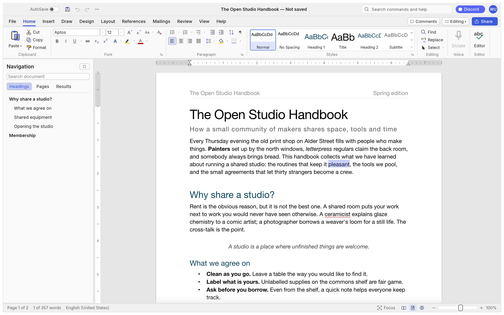
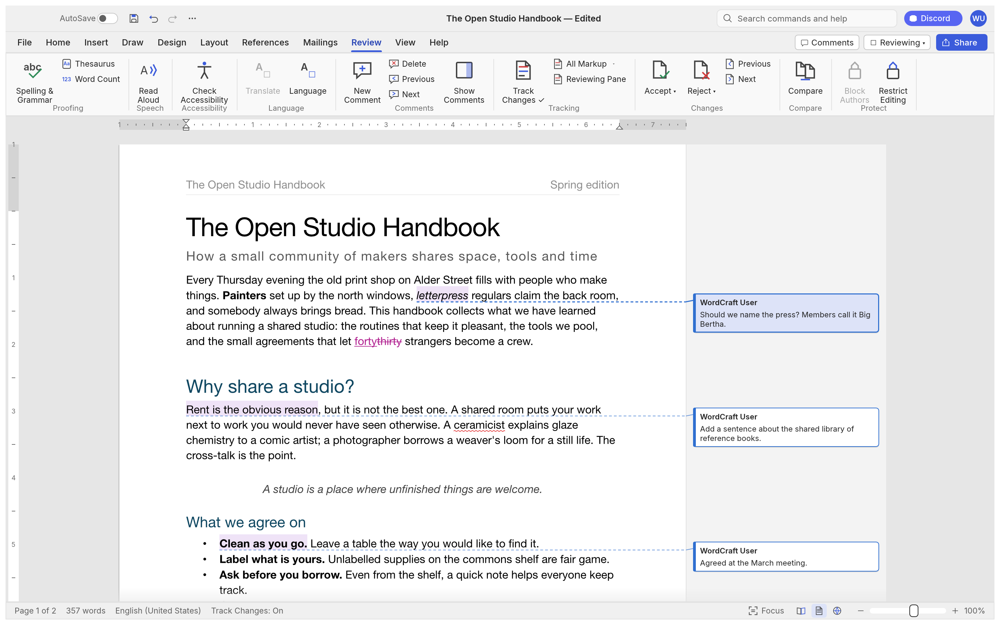
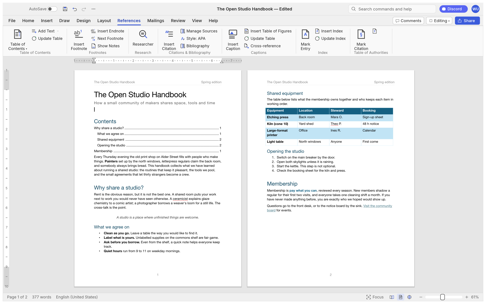
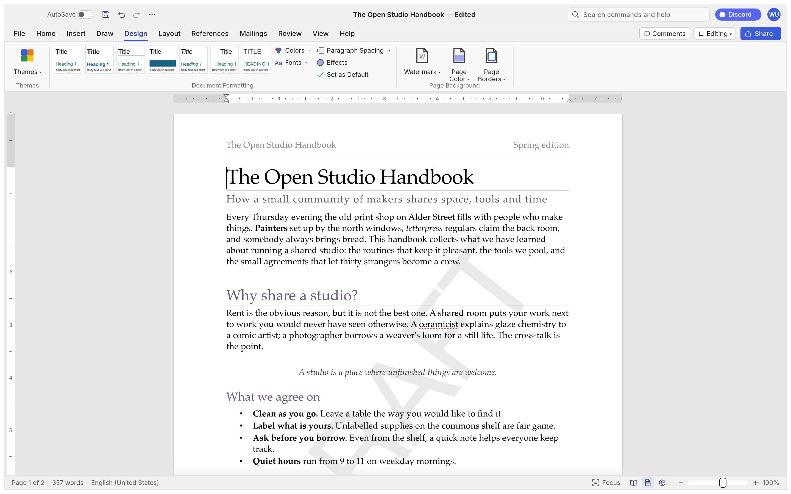
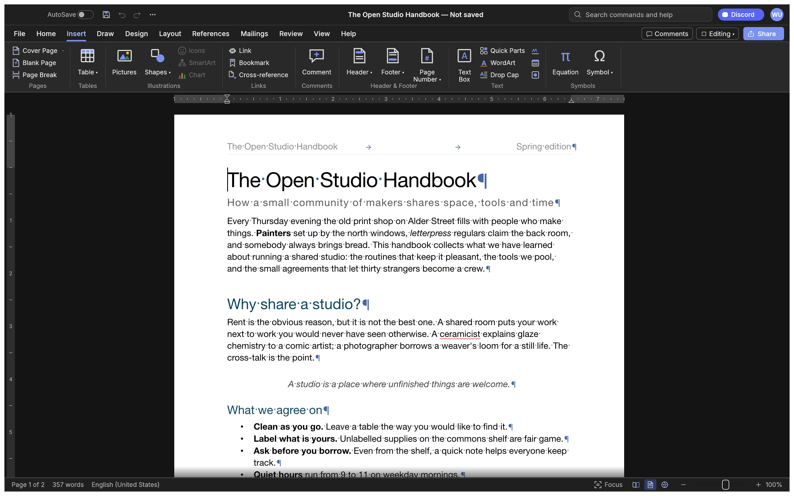
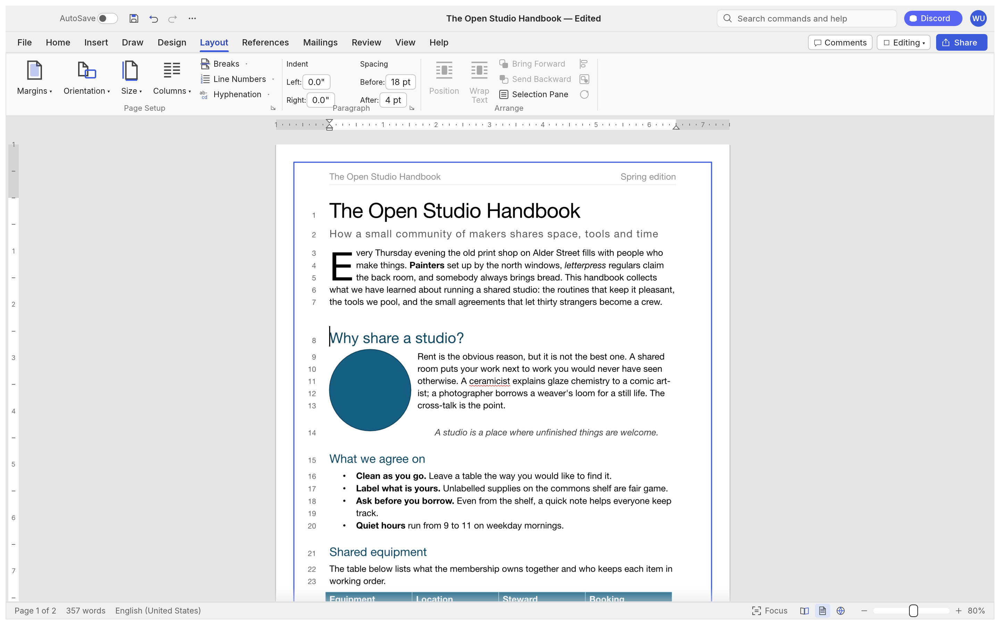
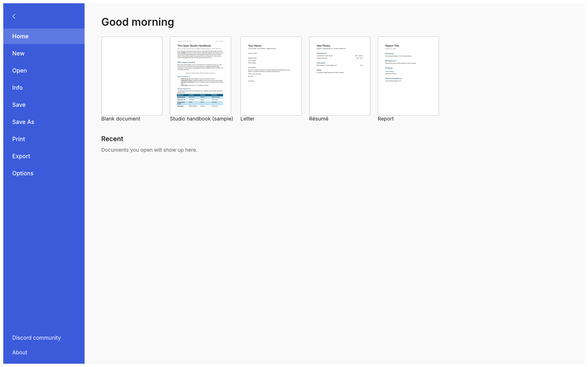

<p align="center">
  <a href="https://getartcraft.com/">
    <picture>
      <source media="(prefers-color-scheme: dark)" srcset="docs/brand/artcraft-logo-white.svg">
      
    </picture>
  </a>
</p>

<p align="center">
  
</p>

<h1 align="center">WordKing</h1>

<p align="center">
  <a href="README.md">English</a> · <b>العربية</b>
</p>

<p align="center">
  <b>الكتابة وتصميم المستندات؛ معالج نصوص حديث ومجاني، مكتوب بلغة Rust الخالصة.</b>
</p>

<p align="center">
  معالج نصوص سريع ومجاني بسير عمل مألوف: الشريط والأنماط والجداول وتتبّع التغييرات
  والمراجع ودمج المراسلات. يقرأ ملفات .docx ويكتبها، ويعمل أصليًّا على macOS وويندوز
  ولينكس وBSD، وفي المتصفح عبر WebAssembly.<br>
  <i>من Alking.ai.</i>
</p>

<p align="center">
  
  
  
  
  <br>
  <a href="https://sonarcloud.io/project/overview?id=storytold_wordcraft"></a>
  <a href="https://coderabbit.ai"></a>
</p>

<p align="center">
  <a href="https://discord.gg/artcraft"></a>
</p>

<p align="center">
  <a href="https://getartcraft.com/apps/wordcraft"><b>WordKing على getartcraft.com</b></a> ·
  <a href="https://getartcraft.com/">ArtCraft</a> ·
  <a href="https://getartcraft.com/apps">كل تطبيقات Crafting</a>
</p>

<br>

<p align="center">
  
  <br><sub><b>The Open Studio Handbook</b>، نموذج WordKing المدمج: الشريط ومعرض الأنماط الحيّة والمساطر ولوحة Navigation.</sub>
</p>

> [!NOTE]
> **ArtCraft مجتمع من الفنانين من كل الأطياف.** رسّامون ومصوّرون وصنّاع أفلام ومصمّمون
> ومحرّكون وهواة، وأشخاص أخذوا القلم الأسبوع الماضي. إن كنت تصنع أشياء، فأنت منّا.
> **[تعال سلّم علينا على Discord](https://discord.gg/artcraft).**

<p align="center">
  <a href="#جولة">جولة</a> ·
  <a href="#لماذا-wordking">لماذا WordKing</a> ·
  <a href="#ما-يعمل-اليوم">ما يعمل اليوم</a> ·
  <a href="#بداية-سريعة">بداية سريعة</a> ·
  <a href="#للوكلاء-سطر-الأوامر-و-mcp">للوكلاء</a> ·
  <a href="#البنية">البنية</a> ·
  <a href="#خارطة-الطريق">خارطة الطريق</a> ·
  <a href="#التنزيلات">التنزيلات</a> ·
  <a href="#تطبيقات-crafting">تطبيقات Crafting</a> ·
  <a href="#الرخصة-والشكر">الرخصة والشكر</a>
</p>

## جولة

كل صورة أدناه هي WordKing نفسه، مصوّرًا خارج الشاشة بواسطة عدّة اختبار واجهته
(`cargo run -p wordcraft-ui-egui --example ui_shot`).

<table>
<tr>
<td width="50%" valign="top"><p align="center"><sub><b>Review.</b> تتبّع التغييرات، وفقاعات التعليقات في الهامش، والقبول والرفض، والتدقيق الإملائي والنحوي أثناء الكتابة.</sub></p></td>
<td width="50%" valign="top"><p align="center"><sub><b>References.</b> فهارس المحتويات والحواشي والاقتباسات بأنماط APA وMLA وChicago وIEEE والفهرس والتسميات.</sub></p></td>
</tr>
<tr>
<td width="50%" valign="top"><p align="center"><sub><b>Design.</b> السمات ومجموعات الأنماط وتباعد الفقرات والعلامات المائية ولون الصفحة وحدودها.</sub></p></td>
<td width="50%" valign="top"><p align="center"><sub><b>الوضع الداكن</b> مع علامات التنسيق، وتبويب Insert: الجداول والصور والأشكال والارتباطات والرؤوس والتذييلات والحقول والرموز.</sub></p></td>
</tr>
<tr>
<td colspan="2"><p align="center"><sub><b>Layout.</b> الحروف الاستهلالية، والتفاف النص حول الصور والأشكال، والفصل التلقائي للكلمات، وأرقام الأسطر، وحدود الصفحات.</sub></p></td>
</tr>
<tr>
<td colspan="2"><p align="center"><sub><b>File.</b> ابدأ من قالب، أو افتح مستندًا أخيرًا، أو حرّر الخصائص، أو صدّر إلى PDF وصيغ أخرى.</sub></p></td>
</tr>
</table>

## لماذا WordKing

- **مألوف.** تبويبات الشريط ومجموعاته واختصاراته وسلوكه: Enter يتابع القائمة، وTab
  ينزلها مستوى، وCtrl/⌘+B يسمّن الكلمة عند المؤشر، ومعرض الأنماط يعاين حيًّا، وF4 يكرّر،
  وF7 يدقّق الإملاء، وF8 يوسّع التحديد.
- **ملفاتك.** يفتح ويحفظ ‎.docx (OOXML)، وكذلك ‎.odt و‎.rtf و‎.html و‎.md و‎.tex (LaTeX)
  و‎.txt؛ ويفتح ملفات ‎.doc القديمة (97-2003)؛ ويصدّر PDF بنص حقيقي قابل للتحديد مع
  ارتباطات وعلامات مرجعية.
- **سريع.** تخطيط الفقرات مخزّن مؤقتًا، فالكتابة في مستند من 188 صفحة تعيد تخطيطه في نحو
  1.4 مللي ثانية؛ والصفحات تُصوَّر عند الطلب.
- **في كل مكان.** قاعدة شيفرة Rust واحدة لـ macOS وويندوز ولينكس وBSD والويب. لا Electron
  ولا Tauri: [egui](https://github.com/emilk/egui) أصلية على كرت الرسوم.
- **مصمّم للوكلاء.** كل إجراء أمر له معرّف. الأوامر الـ422 نفسها تشغّل الشريط واختصارات
  لوحة المفاتيح والبحث عن الأوامر وأداة سطر الأوامر وقناة تحكّم JSON وخادم MCP.
- **خاص.** التدقيق الإملائي والنحوي وكل شيء آخر يعمل دون اتصال.
- **مجاني للجميع.** بلا ثمن، بلا حساب، بلا اشتراك: استخدمه للعمل أو الدراسة أو الاستخدام
  الشخصي كما هو. الشيفرة منشورة لتقرأها؛ وتغييرها يحتاج إذنًا مكتوبًا منّا. وهو نظيف
  الغرفة: بُني من مواصفات عامة ومراقبة، وكل أصل فيه أصلي أو مفتوح الترخيص.

## ما يعمل اليوم

| المجال | أبرز ما فيه |
|---|---|
| **الكتابة** | كتابة سريعة مع IME، وعلامات تنصيص ذكية، وAutoCorrect، وتنسيق القوائم تلقائيًّا (`* `، `1. `)، والشرطات؛ وتحديد كلمة أو جملة أو فقرة؛ والتحديد بالسحب؛ والحافظة مع التنسيق؛ والتراجع والإعادة؛ والبحث والاستبدال بتعبير نمطي |
| **التنسيق** | الخطوط والأحجام وأنماط العريض والمائل والتسطير والشطب والرفع والخفض والأحرف الكبيرة والتظليل والألوان وتباعد الأحرف وفرشاة التنسيق وتغيير حالة الأحرف ومسح التنسيق |
| **الفقرات** | المحاذاة والمسافات البادئة (تُسحب على المسطرة) والتباعد وتباعد الأسطر وعلامات الجدولة بخطوط قائدة والحدود والتظليل والإبقاء مع التالي والتحكّم في الأرامل والأيتام |
| **الأنماط** | مجموعة أنماط مدمجة ومعرض حيّ ولوحة Styles وإنشاء الأنماط وتعديلها وتحديثها ومجموعات الأنماط والسمات |
| **القوائم** | تعداد ونقاط وترقيم متعدّد المستويات وإعادة البدء وتعيين القيمة وصيغ مخصّصة |
| **الجداول** | إدراج بشبكة ودمج وتقسيم وأنماط بصفوف متبادلة الألوان وحدود وتظليل وتكرار صف الرأس عبر الصفحات وصفوف تنقسم عبر الصفحات وفرز وصيغ وتحويل نص ↔ جدول |
| **الصفحات** | الهوامش والاتجاه والحجم والأعمدة وفواصل الصفحات والأعمدة والمقاطع والرؤوس والتذييلات (الصفحة الأولى والفردية والزوجية) وأرقام الصفحات والعلامة المائية وحدود الصفحة وأرقام الأسطر والمحاذاة الرأسية والحروف الاستهلالية والفصل التلقائي للكلمات |
| **الكائنات** | الصور (تحجيم واقتصاص وإعادة تلوين وسطوع وتباين وشفافية وإزالة الخلفية وأنماط صور وتدوير) والأشكال ومربعات النص والموضع العائم مع التفاف النص (مربّع أو أعلى وأسفل أو خلف النص أو أمامه) |
| **المراجع** | فهرس المحتويات والحواشي والتعليقات الختامية والاقتباسات والببليوغرافيا (APA وMLA وChicago وIEEE) والتسميات وجدول الأشكال والإحالات المتبادلة والفهرس وجدول المراجع القانونية |
| **المراجعة** | التدقيق الإملائي والنحوي مع اقتراحات (الإنجليزية والبولندية، بحسب لغة كل مقطع)، والمترادفات، وعدّ الكلمات، والتعليقات في فقاعات هامشية أو في لوحة، وتتبّع التغييرات، والقبول والرفض، ومقارنة المستندات، وتقييد التحرير، وفاحص إمكانية الوصول، وفاحص المستند |
| **المراسلات** | دمج المراسلات من CSV وحقول الدمج وكتلة العنوان وسطر التحية والقواعد والمعاينة والإنهاء إلى مستند؛ والمغلفات والملصقات |
| **العرض** | تخطيط الطباعة وتخطيط الويب والمسودّة ووضع القراءة والتركيز والتكبير وصفحة واحدة أو عدة صفحات وعرض عرض الصفحة ولوحة Navigation والمساطر وخطوط الشبكة والوضع الداكن؛ والواجهة بالإنجليزية و简体中文 و繁體中文 و日本語 وPortuguês (Brasil) وEspañol وУкраїнська وСрпски / Srpski وEesti وTürkçe وРусский وItaliano وDeutsch وPolski وČeština وMagyar وFrançais وБългарски وTiếng Việt و한국어 وSvenska وHrvatski وNederlands وDansk وRomână والعربية (معكوسة) وSlovenščina (تتبع لغة النظام افتراضيًّا) |
| **الملفات** | قراءة وكتابة ‎.docx، واستيراد ‎.doc القديم (97-2003)، وتصدير PDF، واستيراد وتصدير ‎.odt و‎.rtf و‎.html و‎.md و‎.tex و‎.txt، وصور الصفحات |

الصورة الصادقة، مجالًا بمجال، في [ROADMAP.md](ROADMAP.md)، و[تقييم التكافؤ](docs/target-app-parity.md)،
و[قائمة الميزات المولَّدة](docs/parity-checklist.md).

## بداية سريعة

```sh
git clone https://github.com/storytold/wordcraft
cd wordcraft
cargo run --release -p wordcraft -- --sample        # تطبيق سطح المكتب مع المستند النموذجي
cargo run --release -p wordcraft -- report.docx     # فتح مستند
```

ترجمات الواجهة وبيانات الإملاء والفصل تأتي من
[craft-i18n](https://github.com/storytold/craft-i18n)، وهو مُدخل بناء اختياري. لتبني معها،
اسحبها عند الإيداع المذكور في `craft-i18n.rev` ووجّه `CRAFT_I18N_DIR` إليها (مسار مطلق)؛
وبدونها يُبنى WordKing بواجهة إنجليزية، ويتراجع الإملاء الإنجليزي إلى Hunspell الإنجليزي
المثبَّت أو إلى قائمة الكلمات المدمجة في craft-proof، ولا يُفصل بالكلمات إلا البلغارية
والتركية والروسية (بالقاعدة):

```sh
git clone https://github.com/storytold/craft-i18n ../craft-i18n
git -C ../craft-i18n checkout "$(cat craft-i18n.rev)"
CRAFT_I18N_DIR="$PWD/../craft-i18n" cargo run --release -p wordcraft -- --sample
```

سطر الأوامر:

```sh
wordcraft-cli convert report.docx report.pdf        # docx, pdf, odt, rtf, html, md, tex, txt, png
wordcraft-cli convert report.docx report.pdf --strict   # المخرج 3، دون ملف، إن كان حرف أو صورة سيُستبعد
wordcraft-cli text report.docx                      # نص عادي
wordcraft-cli inspect report.docx                   # البنية بصيغة JSON
wordcraft-cli run --template sample \
  --cmd 'select.text={"text":"Membership"}' --cmd format.bold --save out.docx
wordcraft-cli run --script job.json                 # الشيء نفسه من ملف: أوامر، ثم حفظ إلى docx وpdf
```

`convert --strict` (لمخرج ‎.pdf أو ‎.png فقط) و`render --strict` (لصورة PNG لصفحة واحدة)
يرفضان تصييرًا ناقصًا بصمت: يخرجان بالرمز 3 ولا يكتبان شيئًا إن كان المخرج سيرسم حرفًا لا
يملكه أي خط (مربّع فارغ) أو سيستبعد صورة. رموز الخروج: 0 (كُتب)، و1 (مُدخل غير مقروء أو
خطأ في الاستخدام أو `--strict` مع نوع مخرج آخر، ويُفحص قبل قراءة المُدخل)، و3 (رفض صارم).
وعند الخروج بالرمز 3 يحمل stderr سطرًا `wordcraft-cli: strict: …` لكل نوع، ثم سطر JSON
واحدًا:

```sh
wordcraft-cli convert in.docx out.pdf --strict
# wordcraft-cli: strict: 1 character cannot be drawn: U+2D30 (×3)
# wordcraft-cli: strict: 1 picture(s) left out: word/media/image2.bin (header2.xml): unsupported format
# {"schema":1,"strict":"failed","missing_glyphs":[{"cp":"U+2D30","count":3}],"missing_pictures":[{"part":"word/media/image2.bin","source_part":"word/header2.xml","reason":"unsupported_format"}],"truncated":false,"total_missing_glyphs":1,"total_missing_pictures":1,"glyphs_truncated":false,"pictures_truncated":false}
```

سطر JSON (المخطّط 1، وهو أيضًا ما يرجعه `file.strictReport`) يحوي `schema` و`strict`
(`"passed"` أو `"failed"`)، و`missing_glyphs` (عناصر `{"cp", "count"}` مرتّبة بنقطة الترميز)،
و`missing_pictures` (عناصر `{"part", "source_part", "reason"}`: جزء الصورة أو هدفها، وجزء
القصة الذي تقع فيه مثل `word/header2.xml`، ورمز سبب؛ ويكون `source_part` أيضًا
`background` (صورة الصفحة) أو `body` أو `header` أو `footer` أو `footnote` أو `endnote` أو
`comment` أو `text box` حيث لا يُعرف اسم الجزء (مستند لم يُفتح من DOCX)، أو مسار مقطوعة مثل
`word/afchunk1.docx > word/header1.xml` لصورة داخل مقطوعة DOCX مضمّنة)، و`truncated`،
والمجموعين `total_missing_glyphs` و`total_missing_pictures`، و`glyphs_truncated`
و`pictures_truncated` لكل قائمة. ورموز الأسباب هي `missing_part` و`external_target` و
`link_only` و`undecodable` و`unsupported_format`؛ وتستخدم أسطر stderr كلمات عادية عنها.
وعندما تُقطع قائمة يعطي سطر stderr المجموع (`300 characters cannot be drawn (first 256 listed)`).
كل قائمة تتوقف عند 256 عنصرًا على حدة؛ ويكون `truncated` صحيحًا إذا قُطعت إحداهما، وتُحصي
المجاميع كل حرف وصورة متمايزين، بما في ذلك ما بعد الحد. ولا تُحتسب إلا الحروف التي يرسمها
المخرج (لا النص المخفي ولا المحذوف دون `--markup`)، والحرف الذي يرسمه خط بديل مقبول. ويُحتسب
أيضًا النص داخل صورة WMF أو EMF، مشكّلًا بالخط الذي تسمّيه الصورة دون بديل. وحرف منطقة
الاستخدام الخاص يفشل فقط إن لم يربطه أي خط مثبَّت. والنتيجة تعتمد على الخطوط المثبَّتة على
المضيف (انظر #5624 لمجموعة خطوط ثابتة). وهدف الصورة الخارجي لا يُجلب أبدًا: يُبلَّغ عنه ولا
يُحمَّل. والصور المُسقطة عند فتح DOCX (جزء مفقود أو هدف خارجي أو صورة `link only` بلا نسخة
مضمّنة) يُبلَّغ عنها لمُدخل DOCX فقط. ولا صفحة لها، فصورة PNG لأي صفحة تُرفض أيضًا بسبب صورة
مفقودة أو خارجية في أي موضع من المستند، بما في ذلك الرؤوس غير المستخدمة. و`render --strict`
يفحص فقط الصفحة التي يكتبها (`--page`؛ و`--scale` لا يهم)، ولا يطبع شيئًا على stdout حين
يرفض، ويبلّغ بالطريقة نفسها. ويأخذ المحرّك `strict: true` في `file.save` و`file.saveAs`
و`file.exportPdf` و`file.exportPng`، و`file.strictReport {markup?, page?}` يرجع التقرير دون
كتابة.

الويب: `cd apps/wordcraft-web && trunk serve`، ثم افتح <http://127.0.0.1:8771/?sample>.

## للوكلاء: سطر الأوامر وMCP

صُمّم WordKing ليُقاد بالناس *وبوكلاء الذكاء الاصطناعي*.

```sh
claude mcp add wordcraft -- wordcraft-cli mcp                  # مستندات بلا واجهة
# حصر الوكيل في مجلدات: wordcraft-cli mcp --automation-read-root DIR --automation-write-root DIR
wordcraft --control 7981 &                                     # أو قُد التطبيق العامل…
claude mcp add wordcraft-app -- wordcraft-cli mcp --connect 127.0.0.1:7981
```

الأدوات تشمل `list_commands` و`execute` و`batch` و`type_text` و`select_text`
و`inspect_document` و`render_page` و`save_document`، ومع تطبيق عامل: `screenshot` و`click`
و`key`. ويستطيع الوكلاء فحص عملهم عبر `inspect_document` دون صور. انظر
[docs/mcp.md](docs/mcp.md) و[بروتوكول التحكّم](docs/control-protocol.md). والماكروات تسجّل
أي تسلسل أوامر وتعزفه (`tools.recordMacro`، `tools.macros`).

## السجلات

يكتب تطبيق سطح المكتب سجلاته إلى stderr وإلى `logs/wordcraft.log` بجوار تفضيلاته: على لينكس
`$XDG_CONFIG_HOME/wordcraft/logs/` (افتراضيًّا `~/.config/wordcraft/logs/`)، وعلى macOS
`~/Library/Application Support/WordKing/logs/`، وعلى ويندوز `%APPDATA%\WordKing\logs\`.
التشغيل من قائمة سطح المكتب أو من Dock لا يملك طرفية، فهذا الملف هو ما يُرفق بتقرير الخطأ:
الأجزاء غير المقروءة من ‎.docx، والصور أو الخطوط التي اضطر تصدير PDF إلى استبعادها،
والانهيارات التي التقطها حارس الأوامر، تُسجَّل هناك. وكل تشغيل ينقل السجل السابق إلى
`wordcraft.1.log` (وذاك إلى `wordcraft.2.log`)، فيبقى سجل التشغيل الذي انهار بعد التشغيل
التالي؛ ويتوقف نمو السجل عند 16 مبيبايت. و`--version` لا يكتب ملفًا، والتشغيل مع
`WORDCRAFT_NO_PREFS` (تشغيلات اختبار الوكلاء) يسجّل إلى stderr فقط. ولا يُسجَّل نص المستند
أبدًا؛ ورسالة الانهيار تحذف النص الذي تقتبسه.

افتراضيًّا تسجّل حزم WordKing عند `info` وكل ما سواها عند `warn`. ويستبدل `RUST_LOG` ذلك
بتوجيهات على نمط env_logger، مثل `RUST_LOG=debug` أو `RUST_LOG=warn,wordcraft_docx=trace`
أو `RUST_LOG=info,wgpu_core=warn`؛ والتوجيه المنتهي بـ`*` يغطّي كل هدف يبدأ به
(`wordcraft*=debug`). والمسجّل في `apps/wordcraft/src/logging.rs`.

## البنية

| الطبقة | الحزمة | العمل |
|---|---|---|
| L0 | `wordcraft-geom` | الوحدات والقياسات |
| L1 | `wordcraft-doc`، `wordcraft-fonts`، `wordcraft-proof` ([`craft-proof`](https://github.com/storytold/craft-libs/tree/main/crates/proof) من craft-libs) | نموذج المستند والتحرير؛ الخطوط والتشكيل؛ الإملاء والنحو والفصل (البيانات: craft-i18n `language-data/`، `CRAFT_I18N_DIR`) |
| L2 | `wordcraft-layout`، `wordcraft-docx`، `wordcraft-formats` | كسر الأسطر والترقيم والجداول والحواشي واختبار النقر؛ OOXML؛ ODT/RTF/HTML/Markdown/TXT |
| L3 | `wordcraft-render`، `wordcraft-pdf` | المصيّر (vello_cpu)؛ PDF ([craft-pdf](docs/shared-pdf.md)، Krilla) |
| L4 | `wordcraft-engine` | الجلسة والتراجع و422 أمرًا وكتالوج ميزات المستند |
| L5 | `wordcraft-mcp` | خادم MCP |
| L6 | `wordcraft-ui-egui` | واجهة معالج النصوص (قابلة للتبديل) |
| التطبيقات | `wordcraft`، `wordcraft-cli`، `wordcraft-web` | سطح المكتب وسطر الأوامر والمتصفح |

يشغّل `cargo xtask ci` التنسيق وclippy ونحو 800 اختبار وفحص نسبة الأصول وفحص الطبقات وبناء
wasm. تعليمات المساهمين والوكلاء: [AGENTS.md](AGENTS.md).

## خارطة الطريق

WordKing في **ألفا**. لديه أوامر تغطّي 98% من ميزات الشريط والقوائم في كتالوج ميزاته
([`docs/parity-checklist.md`](docs/parity-checklist.md)) اليوم؛ وبحساب العمق ودقّة الملفات
والاستقرار وما بقي، نقدّر أنه جاهز لنحو 60% من العمل الحقيقي، ولنحو 55% من عمل أسبوع
مهني نموذجي، ولنحو 63% من الأساسيات اليومية. وتحتاج بيتا اختبارًا على ملفات ‎.docx
واقعية، والحفاظ على المخططات وSmartArt عبر دورة ذهاب وعودة، ودقّة ترقيم أقرب، وجولة
استقرار، وطباعة أصلية. التفاصيل والتقديرات: [ROADMAP.md](ROADMAP.md)
و[مواضع القصور](docs/gaps.md).

## التنزيلات

**نزّل WordKing** من GitHub: [أحدث إصدار](https://github.com/storytold/wordcraft/releases/latest) فيه كل بناء مذكور أدناه، و[كل الإصدارات](https://github.com/storytold/wordcraft/releases) فيها الإصدارات السابقة وملاحظاتها. `<ver>` في أسماء الملفات هو رقم الإصدار، و`SHA256SUMS.txt` يسرد بصمة لكل ملف.

### ويندوز

| البناء | المثبِّت | محمول |
|---|---|---|
| x64 (إنتل/AMD 64 بت) | `wordcraft-<ver>-windows-x64.msi` | `wordcraft-<ver>-windows-x64-portable.zip` |
| arm64 (Snapdragon وأجهزة ARM الأخرى) | `wordcraft-<ver>-windows-arm64.msi` | `wordcraft-<ver>-windows-arm64-portable.zip` |
| x86 (32 بت) | `wordcraft-<ver>-windows-x86.msi` | `wordcraft-<ver>-windows-x86-portable.zip` |

المثبِّت حزمة واحدة مزدوجة النطاق. يثبّت افتراضيًّا لحسابك وحدك، في
`%LOCALAPPDATA%\Programs\ArtCraft\WordKing`، ولا يحتاج صلاحيات مدير؛ واختيار «Everyone on
this computer» في الصفحة الأولى يثبّت في `C:\Program Files\ArtCraft\WordKing` (أو
`Program Files (x86)` لبناء 32 بت) ويطلب مديرًا. ثبّت نسخة واحدة فقط: نسخة بنطاق آخر
تُرفض، فأزل التثبيت أولًا لتغيير الجهة المثبَّت لها WordKing. والمثبِّتات والملفات التنفيذية
موقّعة بالشيفرة.

**إذا لم يُفتح التطبيق على ويندوز:** يهيّئ تطبيق سطح المكتب DirectX 12 فقط افتراضيًّا.
السماح لـ wgpu بإنشاء نسخة OpenGL أيضًا قد يُنهي بعض تعريفات الرسوم (‎`atio6axx.dll` من
AMD) قبل ظهور النافذة، فيومض التطبيق في Task Manager ثم يخرج. و`WGPU_BACKEND` يتجاوز
الافتراضي لأغراض التشخيص (مثلًا `dx12` أو `vulkan`). في PowerShell، من المجلد الذي فيه
الملف التنفيذي:

```powershell
$env:WGPU_BACKEND = "vulkan"
& .\wordcraft.exe
Remove-Item Env:WGPU_BACKEND                     # استعادة الافتراضي للتشغيلات القادمة
```

وتجاوز `gl` صريح قد يعيد انهيار التعريف على الأنظمة المتأثرة. وافتراضات macOS ولينكس
والويب لم تتغيّر.

بناء **32 بت** يستخدم OpenGL حتى مع وجود كرت يدعم DirectX 12. على ويندوز 32 بت يفشل إنشاء
خط رسم DirectX 12 فورًا ويخرج التطبيق قبل ظهور النافذة. و`WGPU_BACKEND=vulkan` (أو `dx12`)
يتجاوز ذلك أيضًا.

**إذا خرج التطبيق فور ظهور نافذته مع «Parent device is lost» في السجل:** يصرّف WordKing
شيدرات DirectX 12 بـ FXC، المصرّف المدمج في ويندوز، فلا يحتاج `dxcompiler.dll`/`dxil.dll`
ويتجاهل أي نسخة يضعها برنامج آخر على `PATH` (#603). و`WGPU_DX12_COMPILER`
(`fxc`، `dxc`، `auto`) يتجاوز ذلك؛ ومع `dxc` يجب أن تكون `dxcompiler.dll` المناسبة
*و*`dxil.dll` بجوار `wordcraft.exe`. و`WGPU_BACKEND = "vulkan"` يتجنب DirectX 12 كليًّا.

**إذا كان التطبيق بطيئًا على حاسوب ويندوز أقدم:** عندما لا يجد DirectX 12 كرت رسوم له
تعريف (مثل رسوم إنتل من الجيل الرابع على ويندوز 11)، لا يعرض إلا المصيّر البرمجي المدمج
الذي يرسم كل إطار على المعالج. ويستخدم WordKing عادة OpenGL بدلًا منه، دون ضبط شيء. وإن
لم يوجد محوّل OpenGL صالح، يمكنه استخدام محوّل WARP البرمجي في DirectX 12. ويسجّل ملف
السجل الاختيار (أسطر تبدأ بـ`graphics:`). ويبقى `WGPU_BACKEND` متجاوزًا له، مثل
`$env:WGPU_BACKEND = "gl"` أو `"dx12"`.

### macOS

| البناء | الملف | ملاحظات |
|---|---|---|
| التطبيق، شامل (Apple silicon + Intel) | `wordcraft-<ver>-macos-universal.dmg` | موقّع وموثَّق |
| أداة سطر الأوامر، شاملة | `wordcraft-cli-<ver>-macos-universal.zip` | موقّعة وموثَّقة |

### لينكس

| الصيغة | x86_64 | aarch64 (ARM64) | ملاحظات |
|---|---|---|---|
| AppImage | `wordcraft-<ver>-linux-x86_64.AppImage` | `wordcraft-<ver>-linux-aarch64.AppImage` | يعمل في أي مكان؛ ويحدّث نفسه بـ [AppImageUpdate](https://github.com/AppImageCommunity/AppImageUpdate) (ملفات `.zsync`) |
| Flatpak | `wordcraft-<ver>-linux-x86_64.flatpak` | `wordcraft-<ver>-linux-aarch64.flatpak` | معزول؛ `flatpak install --user <file>` |
| Debian/Ubuntu | `wordcraft-<ver>-linux-x86_64.deb` | `wordcraft-<ver>-linux-aarch64.deb` | |
| Fedora/RHEL/openSUSE | `wordcraft-<ver>-linux-x86_64.rpm` | `wordcraft-<ver>-linux-aarch64.rpm` | |
| Tarball | `wordcraft-<ver>-linux-x86_64.tar.gz` | `wordcraft-<ver>-linux-aarch64.tar.gz` | يُفكّ في أي مكان |

RISC-V (riscv64): `wordcraft-<ver>-linux-riscv64.tar.gz`، حزمة مضغوطة مُصرَّفة تبادليًّا
لـ glibc 2.39+ (أوبونتو 24.04 وديبيان 13 وأحدث).

**Read Aloud** (Review › Read Aloud) ينطق عبر برنامج نطق مثبَّت على النظام: يجرّب
`espeak-ng` ثم `espeak`، وإذا لم يوجد أي منهما يحدّث Speech Dispatcher. وحزمة `.rpm` توصي
بـ`espeak-ng`؛ وحزمة `.deb` توصي بـ`espeak-ng` أو `speech-dispatcher`، فيثبّت مدير الحزم
أحدهما افتراضيًّا. ومع AppImage أو الحزمة المضغوطة، ثبّت أحدهما بنفسك إن لم يوجد
(`sudo apt install espeak-ng`، `sudo dnf install espeak-ng`، `sudo pacman -S espeak-ng`).
وFlatpak لا ينطق بعد: لا وصول له إلى الصوت ولا يضم `espeak-ng` أو `espeak` أو
Speech Dispatcher.

**Wayland:** على سطح Wayland يعمل التطبيق عبر XWayland عندما يتوفر، لأن winit (مكتبة
النوافذ) لا يدعم سحب الملفات إلى النافذة إلا على X11. لاستخدام خلفية Wayland الأصلية بدلًا
منه (لنص أحدّ مع تكبير كسري مثلًا، على حساب سحب الملفات وإفلاتها)، اختر
**File › Options › Advanced › Linux display server › Wayland**؛ يُطبَّق عند التشغيل التالي
لـ WordKing، ويُعيد **X11 (XWayland)** أو **Automatic** الرجوع. ومتغيّر البيئة
`WORDCRAFT_WAYLAND` يتجاوز الإعداد: `1` لـ Wayland الأصلية و`0` لـ XWayland:

```sh
WORDCRAFT_WAYLAND=1 wordcraft
```

يحتاج XWayland مكتبات X11، وهي مما توصي به الحزم فقط ولا تثبّته الحزمة المضغوطة:
libX11 وlibX11-xcb وlibXcursor وlibXi وlibxkbcommon-x11 (وعلى ديبيان وأوبونتو:
`libx11-6` و`libx11-xcb1` و`libxcursor1` و`libxi6` و`libxkbcommon-x11-0`). وبدونها يفتح
التطبيق على Wayland الأصلية أيًّا كان الإعداد، ويسجّل ما ينقص.

**Arch Linux (AUR).** يحتفظ أعضاء من المجتمع بثلاث حزم AUR؛ والمشروع لا ينشر إلى AUR
بنفسه. ثبّت إحداها:
| الحزمة | ما تثبّته | اخترها عندما |
|---|---|---|
| [`wordcraft-bin`](https://aur.archlinux.org/packages/wordcraft-bin) | الحزمة المضغوطة أعلاه، جاهزة (x86_64، aarch64) | تريد أحدث إصدار دون تصريف (الأسرع) |
| [`wordcraft`](https://aur.archlinux.org/packages/wordcraft) | أحدث إصدار، مبنيًّا من المصدر بـ`cargo` | تفضّل بناء الإصدارات بنفسك |
| [`wordcraft-git`](https://aur.archlinux.org/packages/wordcraft-git) | فرع `main` الحالي، مبنيًّا من المصدر | تريد تغييرات غير منشورة وتقبل بناءً معطوبًا أحيانًا |
مثلًا `yay -S wordcraft-bin` أو `paru -S wordcraft-bin`.

#### حزم المجتمع

هذه الحزم يحتفظ بها أعضاء من المجتمع، لا فريق WordKing.

على Gentoo، تحزم [طبقة ::snakebyte](https://github.com/switch87/snakebyte-overlay) إصدار
لينكس باسم `app-office/wordcraft-bin` (جاهز) و`app-office/wordcraft` (من المصدر):

```sh
eselect repository add snakebyte git https://github.com/switch87/snakebyte-overlay.git
emaint sync -r snakebyte
echo 'app-office/wordcraft-bin ~amd64' >> /etc/portage/package.accept_keywords/wordcraft
emerge --ask app-office/wordcraft-bin
```

### FreeBSD

| البناء | الملف |
|---|---|
| x86_64 | `wordcraft-<ver>-freebsd-x86_64.tar.gz` |

### الويب (WebAssembly)

| البناء | الملف | ملاحظات |
|---|---|---|
| موقع ثابت | `wordcraft-web-<ver>.zip` | يعمل في متصفح حديث؛ استضفه على أي خادم ثابت |

## تطبيقات Crafting

WordKing واحد من **تطبيقات Crafting**: أدوات إبداعية مجانية منشورة الشيفرة من
[Alking.ai](https://getartcraft.com/)، كل واحدة مكتوبة من الصفر بلغة Rust وكل واحدة قادرة
على الوقوف بنفسها.

| | التطبيق | لماذا | الشيفرة | اعرف أكثر |
|:-:|---|---|---|---|
|  | **PhotoCraft** | تحرير الصور: الطبقات والأقنعة والنصوص وملفات PSD حقيقية | [GitHub](https://github.com/storytold/photocraft) | [الموقع](https://getartcraft.com/apps/photocraft) |
|  | **VectorCraft** | الرسم المتجهي | [GitHub](https://github.com/storytold/vectorcraft) | [الموقع](https://getartcraft.com/apps/vectorcraft) |
|  | **FilmCraft** | تحرير الفيديو واللون والصوت | [GitHub](https://github.com/storytold/filmcraft) | [الموقع](https://getartcraft.com/apps/filmcraft) |
|  | **LightCraft** | مكتبة صور وتحويل RAW | [GitHub](https://github.com/storytold/lightcraft) | [الموقع](https://getartcraft.com/apps/lightcraft) |
|  | **PdfCraft** | قراءة PDF وتنظيمه وحمايته | [GitHub](https://github.com/storytold/pdfcraft) | [الموقع](https://getartcraft.com/apps/pdfcraft) |
|  | **EffectCraft** | الرسوم المتحركة والمؤثرات البصرية | [GitHub](https://github.com/storytold/effectcraft) | [الموقع](https://getartcraft.com/apps/effectcraft) |
|  | **DesignCraft** | تنسيق الصفحات والنشر | [GitHub](https://github.com/storytold/designcraft) | [الموقع](https://getartcraft.com/apps/designcraft) |
|  | **FigCraft** | تصميم الواجهات والنماذج الأولية | [GitHub](https://github.com/storytold/figcraft) | [الموقع](https://getartcraft.com/apps/figcraft) |
|  | **WordKing** | معالجة النصوص والمستندات | [GitHub](https://github.com/storytold/wordcraft) | [الموقع](https://getartcraft.com/apps/wordcraft) |
|  | **SoundCraft** | تسجيل الصوت وتحريره | [GitHub](https://github.com/storytold/soundcraft) | [الموقع](https://getartcraft.com/apps/soundcraft) |
|  | **DeckCraft** | العروض التقديمية | [GitHub](https://github.com/storytold/deckcraft) | [الموقع](https://getartcraft.com/apps/deckcraft) |
|  | **CADCraft** | التصميم بمساعدة الحاسوب | [GitHub](https://github.com/storytold/cadcraft) | [الموقع](https://getartcraft.com/apps/cadcraft) |
|  | **GridCraft** | الجداول الممتدة والبيانات | [GitHub](https://github.com/storytold/gridcraft) | [الموقع](https://getartcraft.com/apps/gridcraft) |
|  | **TextureCraft** | تلوين المجسّمات ثلاثية الأبعاد | [GitHub](https://github.com/storytold/texturecraft) | [الموقع](https://getartcraft.com/apps/texturecraft) |
|  | **Craft Anything** | شاهد كيف يعمل أي برنامج، ثم ابنِ برنامجك | [GitHub](https://github.com/storytold/craft-anything) | [الموقع](https://getartcraft.com/apps/craft-anything) |
|  | **SolidCraft** | تصميم ثلاثي الأبعاد بارامتري من Tangency Labs (تطبيق مجتمع) | [GitHub](https://github.com/tangency-labs/solidcraft) | |

و[**ArtCraft**](https://getartcraft.com/) نفسه، استوديو الصور والفيديو بالذكاء الاصطناعي
للفنانين الذين يريدون تحكّمًا حقيقيًّا.

<br>

<p align="center">
  <a href="https://discord.gg/artcraft"></a>
</p>

<h3 align="center">تعال اصنع أشياء معنا</h3>

<p align="center">
  Discord عندنا حيث يجتمع الفنانون من كل نوع: من يرسمون ويصوّرون ويخطّون ويقطعون الفيلم
  ويصفّون الحروف، ومن ما زالوا يكتشفون ما يحبّون صنعه. شارك ما تعمل عليه، أو اطلب مساعدة،
  أو قل لنا ما المعطوب، أو ما تتمنى أن تفعله هذه الأدوات. أيًّا كان وسيطك وأيًّا كانت مدة
  ممارستك، أنت مرحَّب بك هنا.
</p>

<p align="center">
  <a href="https://discord.gg/artcraft"><b>discord.gg/artcraft</b></a> ·
  <a href="https://getartcraft.com/">getartcraft.com</a> ·
  <a href="https://getartcraft.com/apps">تطبيقات Crafting</a> ·
  <a href="https://getartcraft.com/apps/wordcraft">WordKing</a>
</p>

## الرخصة والشكر

WordKing مجاني للجميع، وليس مفتوحًا للتعديل. [رخصة WordKing المجتمعية 1.0](LICENSE)
(وبالعربية في الملف نفسه، اقرأها كاملة) تتيح لكل شخص استخدامه دون مقابل، ولأي غرض، شخصيًّا
كان أو تجاريًّا. ولا تسمح بتعديل WordKing ولا بنشر نسخة معدّلة منه: اسألنا أولًا كتابةً على
**wordking@alking.ai** وسنجيب. ويجوز تمرير النسخ غير المعدّلة مع الاحتفاظ بالرخصة
والإشعارات. حقوق النشر (c) 2026 Alking.ai ومساهمو WordKing. والإشعارات المطلوبة في
[NOTICE](NOTICE).

الخطوط والأيقونات والصور وغيرها من الأصول المضمَّنة تحتفظ برخصها المفتوحة الخاصة؛ وكل واحد
منها مذكور بمؤلفه ومصدره ورخصته في [ATTRIBUTION.md](ATTRIBUTION.md).

قاموس الإملاء الإنجليزي والفصل يأتيان من قائمة كلمات Moby Hyphenator II لـ Grady Ward،
وهي في الملك العام. والإملاء البولندي يقرأ قاموس Hunspell `pl_PL` المثبَّت على النظام (غير
مضمَّن)، وكذلك الإملاء الروسي والبرتغالي والتشيكي والإيطالي والكرواتي والتركي (طريقة
التثبيت: [docs/spelling-dictionaries.md](docs/spelling-dictionaries.md))، وفصل الكلمات
البولندي من أنماط TeX لـ Hanna Kołodziejska وBogusław Jackowski وMarek Ryćko (خيار MIT).
والمستندات النموذجية والقوالب نصوص أصلية كُتبت لـ WordKing.

اسم ArtCraft وشعاره وعلاماته في [`docs/brand/`](docs/brand/) علامات تجارية مملوكة لـ
Alking.ai ولا تغطّيها هذه الرخصة. ولا يجوز استخدامها إلا دون تعديل، وكجزء من هذا المستودع
وWordKing فقط، بموجب [`docs/brand/LICENSE-brand.txt`](docs/brand/LICENSE-brand.txt).
وعلى أي نسخة معدّلة حذفها.

<p align="center">
  <a href="https://getartcraft.com/"></a><br>
  <sub>صنعه <a href="https://getartcraft.com/">Alking.ai</a> ومجتمع WordKing.</sub>
</p>
